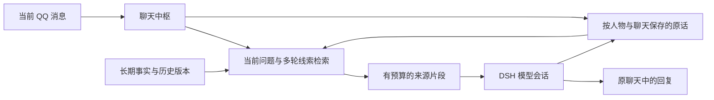

# Aurabot Memory

**为 QQ 角色增加持久对话记忆、多轮线索和可追溯的历史召回。**

这是 [Aurabot](https://github.com/aureth-labs/dsh-aurabot-qq) 的记忆增强分支，基于上游 `b3301f6b014016e141c07d266a716c0fea566aab` / **1.1.24**。增强代码位于 [`persona-memory`](https://github.com/Accelerate11/dsh-aurabot-qq-memory/tree/persona-memory) 分支。

本分支保留上游的 DSH 会话、OneBot v11 网关、面板和模块体系，重点改进聊天中枢与记忆检索。需要从获授权的微信语料构建人物卡和记忆时，配合 [WeChat Persona Skill](https://github.com/Accelerate11/wechat-persona-skill) 使用。

## 本分支增加了什么

| 场景 | 行为 |
| --- | --- |
| 关闭应用后继续聊天 | 用户原话与完成轮次的机器人回复保存在追加日志中，重启后可检索 |
| 对方说“那后来呢” | 使用前几轮对话提供线索，帮助延续话题 |
| 对方明确换话题 | 当前问题优先，避免反复出现的旧主题挤掉新主题 |
| 长对话中间提到的细节 | 按相关性取回较早片段，保留来源消息 ID、角色、时间和发言人 |
| 长篇粘贴旁边的小事实 | 按完整消息和序列化长度分段，避免整组被预算丢弃 |
| “喜欢”变成“不喜欢” | 近似句子不会自动合并；更正保留旧版本，询问过去时可带明确标记召回 |
| 不同人物或聊天 | 原话档案按人物标识和聊天标识隔离，新事实检索按来源聊天过滤 |
| 群聊多人发言 | 保存实际说话者，不把一整段都归给第一个发言人 |

原始对话与提炼后的事实分开。`assistant` 原话只证明机器人曾这样回答，不能自动成为用户事实或原型人物经历。

## 工作方式



- 原话日志位于 Aurabot 数据目录的 `conversation-context/`，按人物和聊天生成独立文件。
- checkpoint 保存检查信息；追加日志保留原话。损坏的日志不会被静默清空。
- 检索使用 BM25 和多个线索的排序合并，当前问题权重高于辅助线索。
- 记忆作为资料附在本轮输入中；完整模型窗口和压缩仍由 DSH 宿主管理。
- 原版事实记忆继续支持日常整理、人物小档案和相处经验；具体启用项由原有配置决定。

设置 `conversationContext.enabled: false` 可关闭这一层的自动记录和注入。新日志不会自动回填升级前的旧聊天流水；额外迁移应保留原时间、说话者和来源。

## 获取与安装

需要 Node.js **22.13+**、DeepSeek Harness 和已配置的 OneBot v11 网关。本分支验证使用 Node.js 24。

克隆增强分支：

```sh
git clone --branch persona-memory https://github.com/Accelerate11/dsh-aurabot-qq-memory.git aurabot-memory
```

如果还没有 Aurabot，先按 [上游安装说明](https://github.com/aureth-labs/dsh-aurabot-qq#安装)完成 DSH 插件与网关设置。QQ 登录、SnowLuma 安装和协议确认由使用者完成。

### 更新现有 1.1.24 安装

配套仓库提供按文件哈希核对的核心安装工具。先获取它，在其目录运行只读检查：

```sh
git clone https://github.com/Accelerate11/wechat-persona-skill.git
cd wechat-persona-skill
python scripts/install_core.py --source ../aurabot-memory --target "<Aurabot安装包目录>"
```

目标目录应包含 Aurabot 的 `package.json` 和 `src/`。工具默认只输出计划，拒绝不支持的版本或独立修改过的文件。

停止或卸载正在使用这些核心文件的 DSH 宿主后，再显式安装：

```sh
python scripts/install_core.py --source ../aurabot-memory --target "<Aurabot安装包目录>" --apply --backup "<新的备份目录>"
```

安装器核验并备份原件，以同目录临时文件原子替换目标，避免写穿 pnpm 硬链接；中途失败会恢复已替换文件。随后重启 DSH，再核对网关连接与人物模块状态。工具不重启应用，也不改账号、密钥、聊天记录或发送配置。

完整步骤和受支持基线见 [配套核心安装说明](https://github.com/Accelerate11/wechat-persona-skill/blob/main/docs/aurabot-core.md)。从更新版本的上游迁移时，应先合并并验证差异。

## 接入自己的角色

[WeChat Persona Skill](https://github.com/Accelerate11/wechat-persona-skill)负责语料筛选、证据审计、情境规律、人物卡和原话索引，并提供独立人物扩展。

在 DSH 加载本分支核心后，人物扩展可使用 `recentMessages` 和 `api.core.hub.recentMessagesOf(chatId, limit)`。配套人物模块的状态接口会显示 `conversationArchive: "aurabot_core"`；同时应核对 `conversationContext.enabled` 已开启。

人物资料与 QQ 发送权限分别配置。安装新人物扩展默认会关闭发送和内置动作，确认人物与账号后再按使用范围启用。

## 原有功能与扩展

原版的语音、表情、心情、空间、社交平台、绘图等能力仍按模块提供；记忆增强不要求把它们全部开启。

- [上游完整使用手册](docs/USER-MANUAL.md)
- [模块事件、工具与接口](src/modules/API.md)
- [记忆架构与迁移边界](docs/MEMORY-CONTEXT.md)
- [人物提取与研究依据](https://github.com/Accelerate11/wechat-persona-skill/blob/main/docs/research.md)

## 测试

基础记忆和完整聊天链路测试使用模拟 DSH 与 OneBot，不需要登录真实 QQ：

```sh
node --test test/conversation-context.test.js test/memory.test.js test/e2e.test.js
```

完整测试：

```sh
npm test
```

部分上游桌宠测试依赖本地当前时间。复核时可在 CI 使用的 UTC 时区运行，例如 PowerShell：

```powershell
$env:TZ = 'UTC'
npm test
```

测试覆盖跨重启召回、长对话中间的证据、超长消息、指代与转题、说话者归属、人物与聊天隔离、否定和事实版本，以及异步消息发送顺序。检索命中和模型正确使用记忆是两个环节，不能只靠单元测试宣称人物相似度。

## 数据与来源

本仓库只提供通用实现和测试，不分发真实人物资料、聊天日志或登录凭证。升级前备份自己的 Aurabot 数据目录。

旧版无聊天范围的事实条目保留原共享行为，不能假设升级后已自动变成私有。新追加日志也不会自动删除，保留期限由使用者管理。

本分支沿用 [MIT License](LICENSE)，保留上游版权与来源。原版项目由 [aureth-labs](https://github.com/aureth-labs/dsh-aurabot-qq) 维护；本分支的记忆与上下文改动由 [Accelerate11](https://github.com/Accelerate11) 维护。
